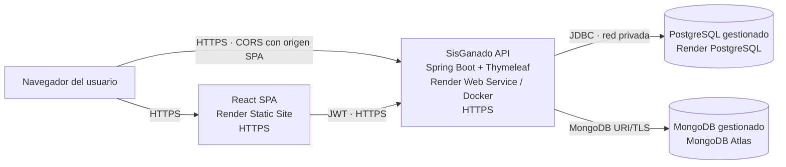

# Diagrama de despliegue

El blueprint `render.yaml` aprovisiona la API, la SPA y PostgreSQL. MongoDB se
crea en MongoDB Atlas y se conecta mediante `SPRING_DATA_MONGODB_URI`. Se debe
configurar `SISGANADO_CORS_ALLOWED_ORIGINS` con el origen HTTPS exacto publicado
por el sitio estático y `VITE_API_BASE_URL` con la URL HTTPS de la API antes de
compilar la SPA.
