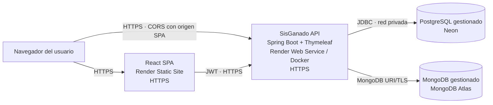

# Diagrama de despliegue

El blueprint `render.yaml` aprovisiona la API Render Free y la SPA estática.
PostgreSQL se crea en Neon y MongoDB en Atlas; se conectan por sus URI/variables
secretas. Se debe
configurar `SISGANADO_CORS_ALLOWED_ORIGINS` con el origen HTTPS exacto publicado
por el sitio estático y `VITE_API_BASE_URL` con la URL HTTPS de la API antes de
compilar la SPA.
