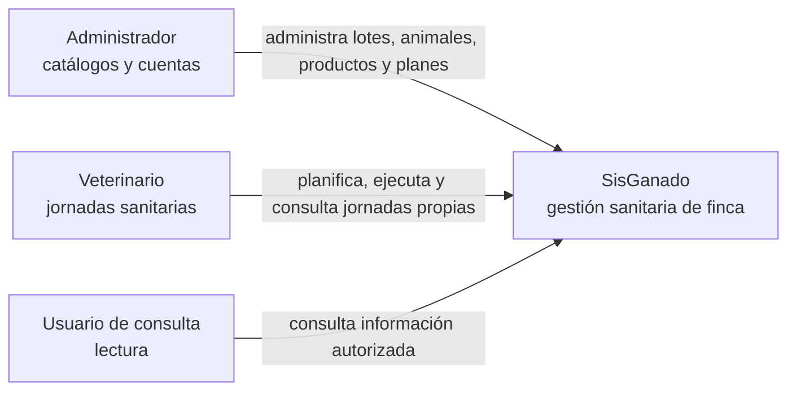
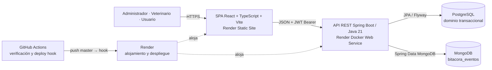
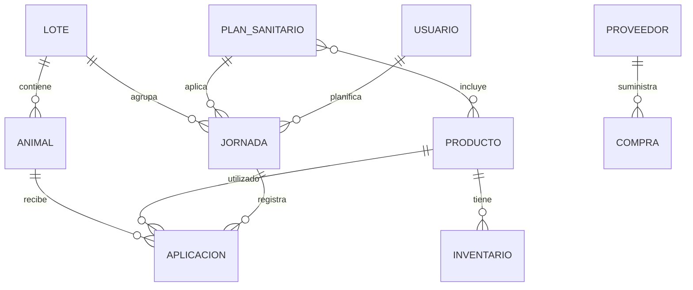

# Arquitectura de SisGanado · Defensa final

## Diagrama C4

### Nivel 1: contexto

### Nivel 2: contenedores

La API publica recursos bajo `/api/v1`. La SPA y la API son servicios
independientes; `VITE_API_BASE_URL` determina a qué URL se conecta la interfaz.
PostgreSQL y MongoDB se configuran con variables del entorno, no con secretos
incluidos en el código.

## Modelo de datos

PostgreSQL conserva los datos operativos y sus relaciones:

La bitácora `bitacora_eventos` en MongoDB guarda cada evento como documento
independiente con entidad, acción, usuario, detalle y fecha. Los detalles del
modelo relacional, migraciones e índices están en
[modelo-datos.md](../BACKEND/docs/modelo-datos.md).

## Seguridad

- La API autentica con JWT Bearer firmado con HS256; la clave de producción se
  suministra mediante `SISGANADO_JWT_SECRET`. Las contraseñas se guardan usando
  BCrypt, nunca como texto plano.
- `/auth/login` y `/auth/register` son públicos; el resto de `/api/v1/**`
  requiere autenticación. La inscripción pública no permite crear ADMIN:
  USUARIO queda activo con permisos de lectura y VETERINARIO requiere
  aprobación administrativa.
- Los permisos se verifican por rol y operación. ADMIN mantiene catálogos y
  cuentas; ADMIN/VETERINARIO gestionan jornadas; USUARIO consulta. La
  autorización de propiedad evita que una cuenta opere jornadas ajenas.
- 401 indica que falta una autenticación válida; 403, que la identidad no tiene
  permiso suficiente. Las respuestas API usan Problem Details.
- `SecurityEventLogger` registra eventos de autenticación con claves
  estructuradas. CORS permite los orígenes configurados en
  `SISGANADO_CORS_ALLOWED_ORIGINS`.
- El despliegue debe mantener secretos fuera del repositorio. Los datos de
  demostración son artificiales; `SISGANADO_DEMO_DATA_ENABLED` permite
  desactivar la carga tras la presentación.

## Lecciones y límites conocidos

1. Las reglas sanitarias y transacciones deben vivir en servicios, no en
   controladores; así se pueden probar tanto reglas individuales como rollback
   de un flujo completo.
2. PostgreSQL y MongoDB resuelven necesidades diferentes, pero añaden
   operación y no comparten una transacción ACID distribuida.
3. La ejecución consume existencias y concentra contención; el bloqueo
   transaccional y `@Version` evitan aceptar actualizaciones obsoletas. Una
   prueba de integración verifica el conflicto como HTTP 409.
4. El plan gratuito de Render puede tener arranques en frío y límites de
   capacidad; para disponibilidad sostenida y datos reales se requieren
   respaldos, monitoreo y recursos de producción adecuados.
5. El pipeline verifica cambios antes de activar el deploy hook. Un workflow
   exitoso demuestra que pasaron sus checks, pero no sustituye una prueba
   funcional posterior en las URLs desplegadas.

## Guion breve de demostración

1. Iniciar sesión con ADMIN y mostrar los catálogos y cuentas.
2. Planificar una jornada con lote y plan existentes.
3. Mostrar la jornada y ejecutar una con animales activos y dosis válidas.
4. Consultar el costo y explicar cómo se consume inventario y se conserva la
   trazabilidad.
5. Mostrar `/actuator/health`, el workflow de GitHub Actions y estos diagramas.
